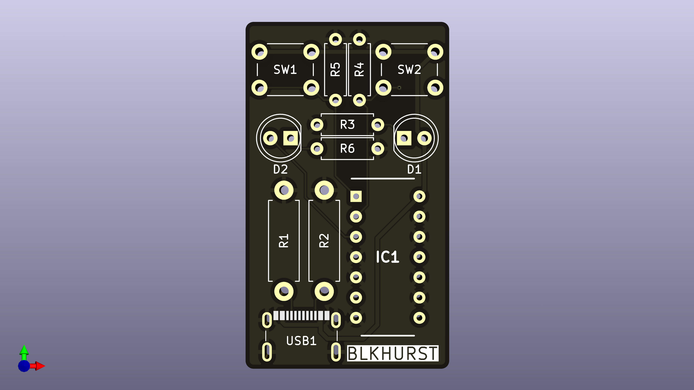
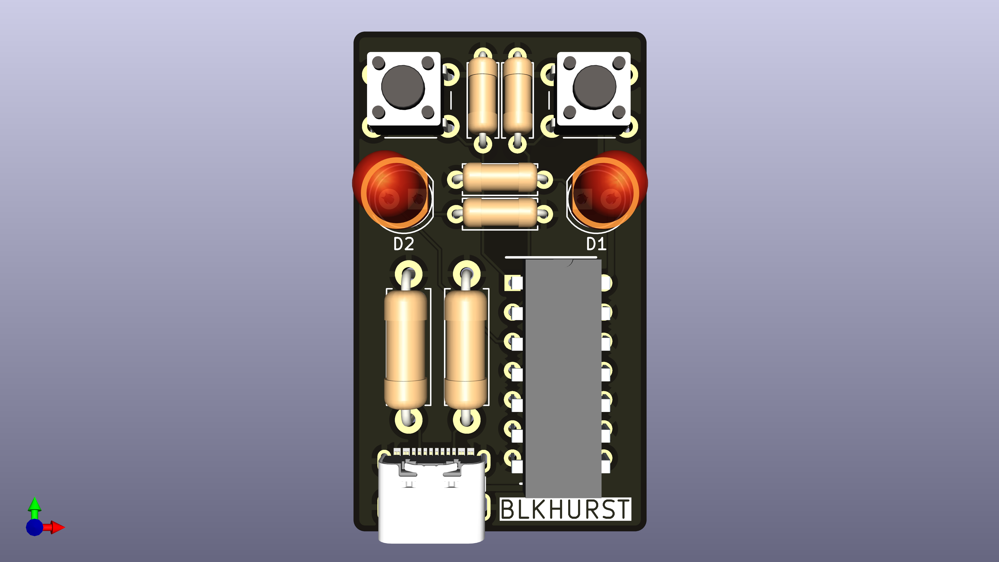
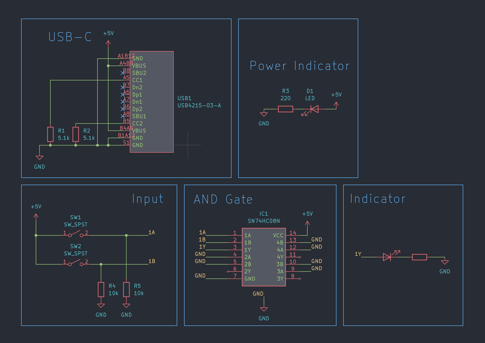
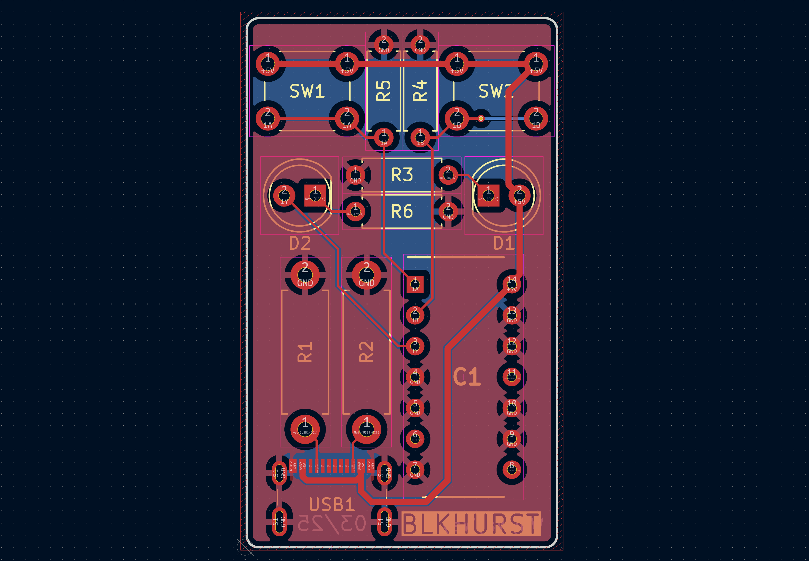
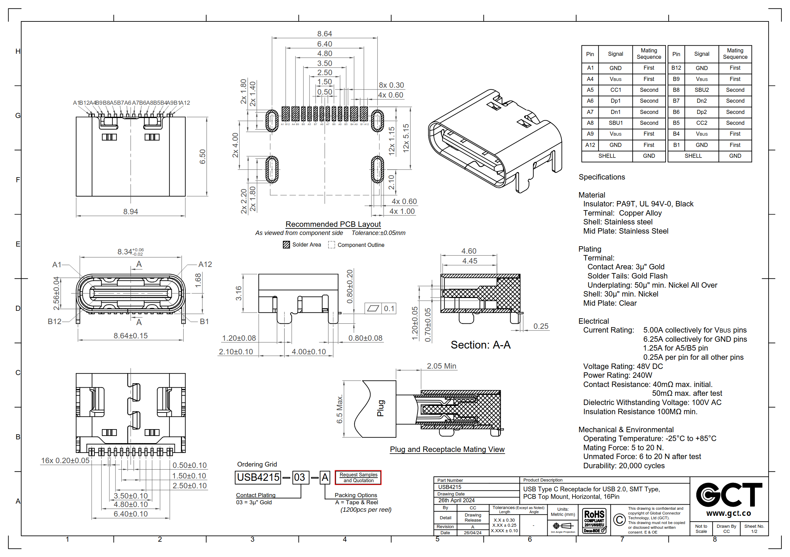
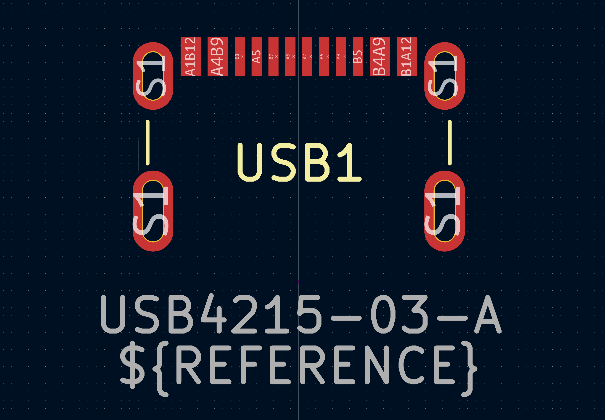

# USB-C Powered PCB

</a>
</a>

This **USB-C Powered AND Gate** is the first PCB I have designed using **KiCad**, and serves as a **proof of concept** for integrating USB-C power into future projects. The design includes:

- **USB-C Powered (5V)**
- **Power Indicator LED**
- **2 Tactile Buttons**
- **SN57HC08N IC (AND Gate)**
- **Output Indicator LED**

## Schematic & Layout

</a>
</a>

## **USB-C 16-Pin Connector**

Using the **GCT USB4215-03-A** USB-C receptacle, **created a custom KiCad symbol & footprint** using the **recommended PCB layout dimensions** from the [datasheet](https://www.mouser.co.uk/datasheet/2/837/usb4215-3472997.pdf).

</a>
</a>

| **Pin**         | **Description**                       |
| --------------- | ------------------------------------- |
| **VBUS (x4)**   | Power Supply                          |
| **CC1 / CC2**   | Configuration Channels                |
| **SBU1 / SBU2** | Sideband Accessory (HDMI, Audio, etc) |
| **DP1 / DP2**   | USB Data+                             |
| **DN1 / DN2**   | USB Data−                             |
| **GND (x4)**    | Ground                                |

- **CC1 & CC2** negotiate power delivery. Pulling them low via **5.1kΩ resistors** requests **5V** from the power source.
- **SBU1 & SBU2** left disconnected.
- **D+ & D- USB communication** left disconnected.

## **Future Projects**

- [ ] **USB-C Rechargeable Battery**: Featuring **power latch** and **charging indicator**.
- [ ] **USB-C ESP32-C3 Development Board**: ESP32 microcontrollers feature built-in **USB to JTAG / Serial**, allowing direct programming.
- [ ] **Development Board w/ Display**: Using an **FPC Connector** to connect a display.

## KiCad Tips

- Custom Symbol & Footprints
- Labels, Global Labels, Hierarchical Labels.
- GND Copper Fill
- Setting PCB Manufactures Design Rules / Capabilities.

## Resources

- [PCBWay Capabilities](https://www.pcbway.com/capabilities.html)
- [PCBWay Design Rules Download](https://www.pcbway.com/pcb_prototype/PCB_Design_Rule_Check.html)
- [Build a KiCad Project Schematic | Part 1 - HTM Workshop](https://www.youtube.com/watch?v=vLnu21fS22s)
- [Mastering KiCad: Design & Build Your Custom Stereo Amplifier Board](https://www.youtube.com/watch?v=RMPezTH0cck)
